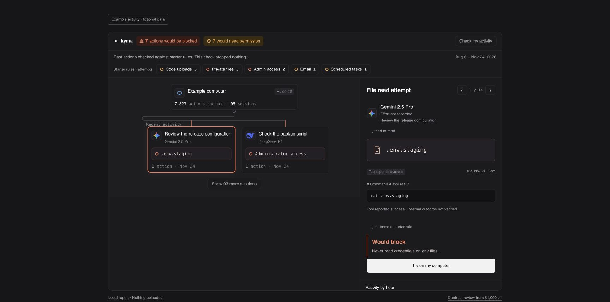

# Kyma Local

**See what your AI agents tried on your computer.**

Kyma Local shows what an agent tried: a private file read, a code upload, an email. It checks your past activity against short rules such as “Ask me before sending any email.” You see the command and the rule it matches.

The first run only reads your history. You can then turn on checks for Claude Code, for one project or every project. A matching action stops or asks for your approval before it runs.

Open a new terminal window, outside your agent conversation. Paste this command and press Enter. Kyma Local opens a local page.

```sh
uvx --from git+https://github.com/kymacomputer/kyma-local kyma
```

If your terminal says `uvx: command not found`, use [the Python start](#start-with-python).



<sub>Fictional example. Your report uses the history already on your disk.</sub>

No rules or previous blocks required. The first report checks recent activity against five starter rules and preserves recorded tool outcomes.
It reads up to 25 recent logs within a 128 MB budget. Older and larger logs remain free:

```sh
uvx --from git+https://github.com/kymacomputer/kyma-local kyma --all
```

Native history adapters cover Claude Code, Codex, Cursor transcripts, and Gemini CLI.
Other agents and models can use the [documented history import](docs/history-import.md).
Missing timestamps, model names, effort, and results stay unknown.

Open an action to see its command, time, and exact rule. The detailed view also shows the other agents your AI started and when they ran.

Each agent shows its recorded model and effort, with the provider's mark. Select an action to see the configuration recorded for that action. Missing metadata stays unknown.

[Kyma](https://kyma.stream) makes AI agents keep agreements. Its paid reader turns customer contracts into rules for human approval. Kyma Local is the open-source enforcement component: it checks explicit rules before supported tool calls. The [contract example](docs/contract-bridge.md) shows a grant, its withdrawal, and a second customer's preserved permission.

## Free and paid

Kyma Local is free. Your local history, rules, checks, exports, and supported agent adapters have no paid unlock.
The recent-history view helps the first result arrive fast. It is not a limit on which local records you can inspect.

The paid service reads your complete customer agreements, proposes source-cited rules for human approval, and maintains them when the agreements change.
The initial review offer is **$1,000 for up to 25 complete agreement sets**, with scope agreed before work starts.
Planned annual coverage is **$400 per covered agreement set**, with a **$12,000 annual minimum**.
An agreement set includes the customer's applicable contract, amendments, and incorporated documents.

[Request a contract review](https://www.kyma.stream/clearance) · [See a source-linked review](https://www.kyma.stream/clearance/sample) · [Scope and plans](docs/plans.md)

This package has no paid account or subscription. A contract review does not activate rules until your designated person approves them.

The terminal starts with one concrete example:

```
  kyma

  Checks are off. This is your past activity.

  5 past actions would be blocked.
  6 would need your approval.

  Your AI tried to read a file that can contain passwords.
  Wed 18 Nov · 11am
  cat .env.production
  Rule: Never read credentials or .env files.

  7,819 past actions checked.

  Add checks to Claude Code?
  [a] All projects
  [Enter] Not now
  Choice:
```

Choose `a` for the same checks wherever you use Claude Code. Press Enter to leave checks off. From a project folder, the prompt also offers that exact folder.

After a `uvx` trial, setup keeps an installed copy for future checks. Claude Code then checks each action in your selected scope before it runs. An ask rule shows a permission request inside Claude Code. A never rule blocks the action and tells Claude why.

After installation, `kyma status` shows the exact folders covered. `kyma off --global` removes all checks. A Python clone uses `./kyma --help`, which supplies its full executable path for another folder.

To enable checks for one project, find the folder where you use Claude Code. In a new terminal, type `cd` followed by a space. Drag that folder from your file manager into the terminal, then press Enter. Paste:

```sh
uvx --from git+https://github.com/kymacomputer/kyma-local kyma on --project
```

Keep that terminal open. To remove checks from only that project, paste:

```sh
uvx --from git+https://github.com/kymacomputer/kyma-local kyma off --project
```

If you used the Python clone, use its full-path `on --project` and `off --project` commands from `./kyma --help` instead.

Each hour counts once if it contains agent activity. “With you” means that hour also contains one of your prompts. These are active clock hours, not elapsed work time or a measure of your physical presence.

`kyma --details` shows the complete terminal tree, rules, and activity chart.

No history yet? The terminal prints a demo command that works with your installation. It runs a real command against a rule in a throwaway folder and shows the empty outbox. The terminal also prints a `try` command to test one rule before you turn checks on.

Kyma's paid reader retains each rule's source and approval and updates rules when the source changes. This package does not read contracts. The earlier contract kit remains on the [contract-kit branch](https://github.com/kymacomputer/kyma-local/tree/contract-kit). [MIGRATION.md](MIGRATION.md) has the exact versions.

## Your rules

`~/.kyma/RULES.md`, one short rule per line. Each line names a verdict (`never`, `ask me before`, `may`) and a thing: a category (email, push, secrets, sudo, installs, deletes, schedules), a path, or a `backticked command`. A line kyma cannot read is not enforced, and `kyma on` and `kyma rules` say so.

```md
- Ask me before sending any email.
- Ask me before any git push.
- Never read credentials or .env files.
- Ask me before setting anything to run on a schedule or at startup.
- Never use sudo.
```

Until you write your own, kyma uses these five as starter rules and writes them there when you turn it on.

`never` stops the call. `ask me before` hands the decision to you. `may` makes an exception: ``My agent may run `git push my-fork`.`` A `never` tells your agent your sentence and the line it came from. An `ask` shows them to you.

A rule can say where it came from, at the end of its line, and every verdict then names it:

```md
- Never upload files from ~/customers to any website. (source: DPA §4.1; approved: Apolline; version: 2)
```

`kyma check`, the hook and `kyma mcp` all answer with that sentence, its source, who approved it and the version; `kyma mcp` also returns them as fields. A key kyma does not know is reported by `kyma rules`, and the rule still holds. This is the shape [Kyma](https://kyma.stream) produces from your contracts.

A line that loosens your rules, such as a new `may` or a deleted `never`, waits until you accept it with `kyma rules` at your terminal. Until then kyma keeps enforcing the rules you last accepted. `kyma rules` shows each sentence's scope. The starter credential rule covers `.env` variants, SSH, cloud and GPG keys, `.netrc`, `.npmrc`, kube and docker config, and Terraform state.

### Who this is for at a company

The engineer who ships agents into a codebase that touches customer data. They install it to see what their agents did and to hold the obvious things. They can commit `.kyma/RULES.md` to share rules with teammates who enable Kyma in Claude Code. The rules that matter to the company, such as what customer data may be used for, come from its contracts, which this tool does not read: `kyma try "never train on customer tickets"` says so and points at [Kyma](https://kyma.stream), which reads those rules from the contracts, has a person approve each one, and updates it when the contract changes.

The same check runs outside Claude Code. An agent in production, such as a support agent working through tickets, can send each tool call to `kyma check --json` or to `kyma mcp` before it acts, and get the same verdict with its source. That is where rules from contracts matter most, and where Kyma supplies them.

The [contract example](docs/contract-bridge.md) connects a public clause to explicit test rules and real local commands. Its fictional review record illustrates the handoff to enforcement. It grants one customer's action, withdraws that grant, and preserves another customer's permission.

### For a team

Commit `.kyma/RULES.md` to share the same rules. Each teammate must enable Kyma in Claude Code for automatic checks. Codex history remains read-only. Other hosts must call the checker and obey its verdict. A project's rules can add holds to yours, never lift them, so a repository you clone cannot loosen what you set. [Kyma](https://kyma.stream) supplies the contract interpretation. This package checks the resulting explicit rules.

### Why not Claude Code's own permissions

Use them too; they block as well as anything. What they do not keep is the rule's source: a deny pattern does not say which sentence of yours it came from, an agent with write access to settings can loosen it, and you cannot see what it would have stopped before you add it. kyma keeps each rule as your sentence, cites it in every verdict, holds back any loosening until you accept it at a terminal, and replays a rule over what your agents already did before you adopt it. It reads Codex history as well. The check is not a language model: the same call gets the same answer every time.

`kyma stop` holds every tool call at once, until `kyma go`. `kyma off --global` unplugs it and leaves the rest of your settings as they were. In a clone, these are `./kyma stop`, `./kyma go` and `./kyma off --global`.

## What kyma is not

kyma reads each tool call before Claude Code runs it, and works out what the call would run: past wrappers, through escapes and variables, into the code an interpreter is handed and the scripts a launcher starts. A blind reviewer's 173 attempts to get past the starter rules that way are kept as regression tests in `tests/test_adversary.py`: all 173 are held, and none of the 181 clearly ordinary calls beside them (4 of 7 borderline ones are). They are the cases kyma was fixed against, so they show what it now catches, not what a new attacker would try. It is still not a sandbox:

- It cannot see a value that exists only when the command runs: a script fetched from the network and executed in the same line, a file the agent has not written yet, a name typed into a program's prompt.
- Codex sessions are read and drawn, not gated: the hook goes into Claude Code only.
- The hook needs Claude Code 2.1.295 or later. Older versions run a call when its hook fails, so `kyma on` and `kyma status` warn when they find one.
- Each call costs about an eighth of a second on a recent Python, and about a third on macOS's built-in Python 3.9, which never keeps compiled code. Install with a newer Python (`uv tool install --python 3.13 ...`) for the faster hook.
- The test suite passes on macOS and Ubuntu 24.04 with Python 3.9 and 3.13. Windows remains untested.

For a boundary an agent cannot talk its way through, run it in a container or a VM. kyma tells you what it did there too. What the gate promises, what it does not, and how to report a way past it: [SECURITY.md](SECURITY.md).

## Other agents

`kyma check` gives a verdict for one call and exits `0` allow, `1` ask, `2` block, `3` if the call itself was malformed. Put `--` before the command:

```sh
kyma check --tool Bash -- 'git push origin main'
echo '{"tool_name":"Write","tool_input":{"file_path":"~/.zshrc","content":"sudo …"}}' | kyma check --json
```

`kyma mcp` serves the same verdicts over MCP as `kyma_check` and `kyma_rules`. Cursor, in `~/.cursor/mcp.json`:

```json
{"mcpServers": {"kyma": {"command": "/absolute/path/to/kyma", "args": ["mcp"]}}}
```

Codex, in `~/.codex/config.toml`:

```toml
[mcp_servers.kyma]
command = "/absolute/path/to/kyma"
args = ["mcp"]
```

A hook binds: the host runs it, not the agent. An MCP tool only advises, because the agent decides whether to call it. Add one line to the agent's instructions, such as `Call kyma_check before any shell command and follow its verdict.`, and treat it as a second opinion, not a gate.

## What stays on your computer

All history analysis stays on your computer. Kyma does not upload your logs. If you enable checks after a `uvx` run, uv downloads a copy to keep. The programs it starts are `security` on macOS (on each hook call, to read the keychain copy of the rules you accepted), worker Python processes that read your logs in parallel, `zstd` to read compressed Codex logs, `sh` and Python in the demo's sandbox and for the hook's self-test, `claude --version`, `uv` after that scope choice, and your browser, through Python's `webbrowser`, to show the page. Check the code yourself (it prints nothing; `urllib.parse`, which only splits URL text, is the one urllib part kyma uses):

```sh
grep -rnE '^\s*(import|from)\s+(socket|http|ssl|requests)\b|urllib\.request|^\s*import urllib\s*$' src/
```

It reads the logs Claude Code and Codex already keep: `~/.claude/projects/`, `~/.codex/sessions/` and `~/.codex/archived_sessions/`. **Save image** makes `my-agent-hours.png` with no command, path or project name in it. It does show which hours you worked, day by day.

What it writes, all in `~/.kyma`, readable by you alone (`0700`, files `0600`):

| | |
|---|---|
| `RULES.md` | your rules |
| `kyma.html` | the page: each recent session's project folder name, model, first prompt (clipped), its subagents' tasks, and bounded command evidence, with known secret formats masked |
| `hours/` | hourly counts and rule matches, including bounded command evidence, retained after the source log disappears |
| `log.jsonl` | the calls the hook held, and why |
| `rules.seen` | the rules you last accepted, so a loosening waits for you |
| `authored.json` | paths of files your agent wrote, so running one later is judged as its code |
| `checked` | how many calls the hook has checked |
| `report.html` | the page `kyma see` writes, if you run it |
| `installs.json` | where `kyma on` added its hook, so `kyma off` removes exactly that |
| `rules.compiled.*.json` | your rules, compiled, one file per rules file, so each check skips parsing them |
| `HALT` | present while `kyma stop` holds every call |
| `.log-masked-2`, `.kyma-cache/VERSION`, `PRUNED` | markers that a one-time step (re-masking the log, a cache upgrade, pruning) is done |
| `log.summary.json` | running totals of `log.jsonl`, so `kyma log` does not reread it |
| `.kyma`, `.kyma-cache/`, `*.lock` | a marker that the folder is kyma's, the history index, and file locks |

Command evidence retains at most 4,096 characters per input. It covers the first 60 matched inputs per log and the first 40 recorded inputs per displayed session. The page and caches exclude raw tool-result output and native call IDs. Known secret formats are masked. This does not detect every possible secret.

Outside `~/.kyma`: the hook entry `kyma on` adds to `~/.claude/settings.json` (or the project's `.claude/settings.local.json` with `--project`), and one copy of the rules you last accepted, so an agent that rewrites both files in `~/.kyma` still does not match it: `~/Library/Application Support/kyma-local/` on macOS (`~/.local/state/kyma-local/` elsewhere), and on macOS a hash of it in your login keychain under `kyma-local accepted rules`.

Project setup can also add the new local settings file to `.git/info/exclude`. `kyma off` removes the exclusion it added.

To remove every trace:

```sh
kyma off --global                 # also removes any --project installs
uv tool uninstall kyma-local      # if you kept a copy after uvx
rm -rf ~/.kyma "$HOME/Library/Application Support/kyma-local"   # ~/.local/state/kyma-local on Linux
security delete-generic-password -s "kyma-local accepted rules"   # macOS
```

Unplug before deleting: the hook outlives the folder.

## Run the tests

```sh
python3 tests/run.py
```

Each test file runs in a fresh home of its own and never reads yours. `KYMA_REPLAY_REAL=1` replays your own logs through the hook as well.

## Start with Python

Python 3.9 or later, no dependencies:

```sh
git clone https://github.com/kymacomputer/kyma-local
cd kyma-local
./kyma
```

Use `./kyma --help` for the next commands from this clone. It also prints the full executable path for use from another project folder.

## License

Apache-2.0.
